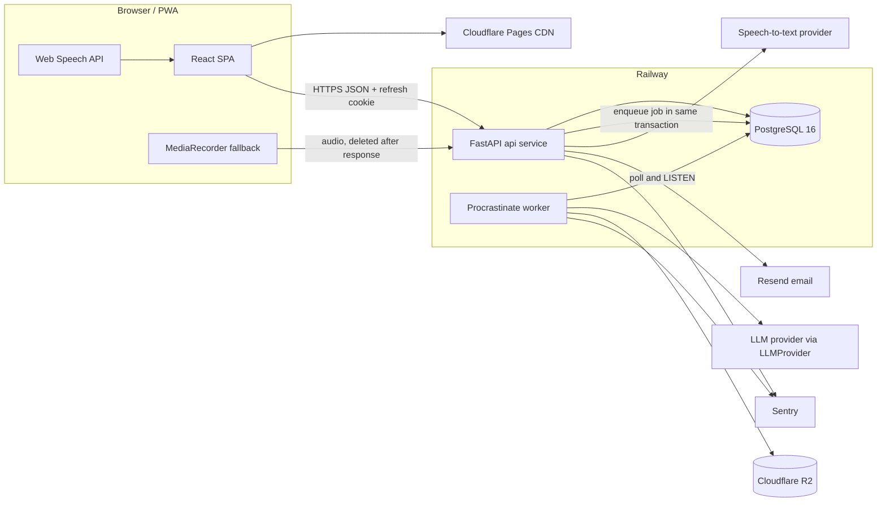
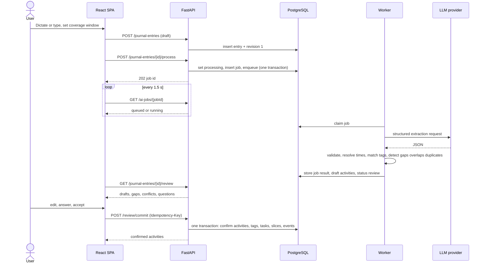
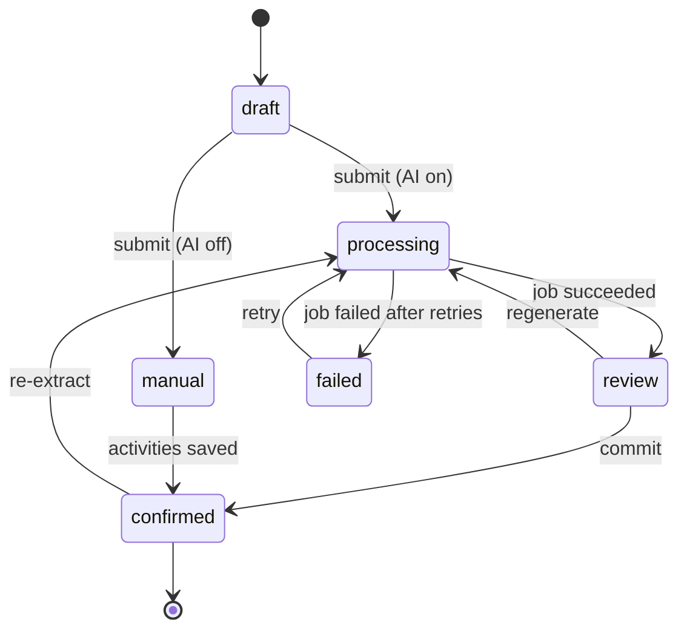
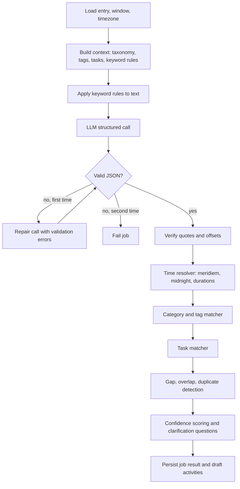
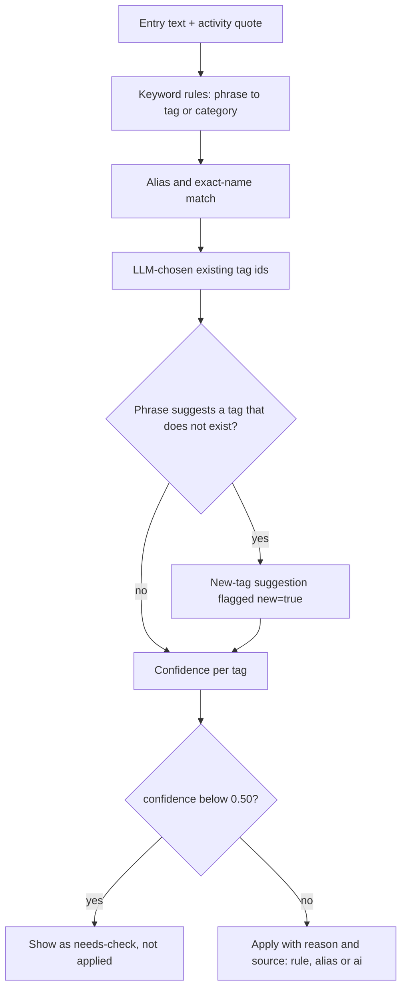
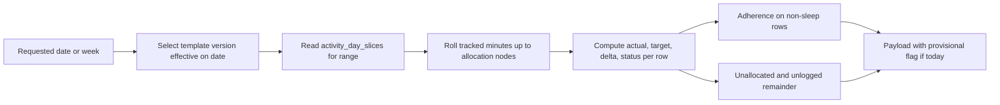

# 3–4 · Technology Stack & System Architecture

**Decision:** a React single-page app on Cloudflare Pages talks over REST to one FastAPI service with a Postgres-backed worker, all on Railway, using Postgres for data, queue and analytics. No Redis, no Kubernetes, no separate analytics store. This is the simplest stack that supports the AI pipeline, exact time arithmetic, and a later mobile client.

## 3. Recommended technology stack

| Layer | Choice | Responsibility | Why it fits | Limits / risks | Extra complexity? |
| --- | --- | --- | --- | --- | --- |
| Frontend framework | React 18 + TypeScript + Vite | All screens, charts, dictation UI | Design is a dense client app with custom SVG charts; no SEO need, so no SSR | Bundle size needs code-splitting for charts | None |
| Routing | React Router 6 | Routes, URL-held filters (`?scope=week&date=`) | URL state makes chart clicks shareable | — | None |
| Server state | TanStack Query v5 | Fetch, cache, retry, optimistic updates, polling for AI jobs | Handles polling and invalidation after commit | Cache keys must be disciplined | None |
| UI state | Zustand | Theme, dictation state, review selection, dialogs | Tiny, no boilerplate | Do not store server data here | None |
| Forms | React Hook Form + Zod | Validation shared with API shapes | Type-safe, fast | — | None |
| Styling | Tailwind CSS + CSS variables (design tokens) + Radix UI primitives | Layout, light/dark theming, accessible dialogs, popovers | Tokens map 1:1 to the design file; Radix gives focus management | Tailwind class noise | None |
| Charts | Custom SVG components using `d3-scale`, `d3-shape`, `d3-hierarchy` | 24h clock, treemap, heatmap, grouped bars, donut, lines | Hover spec is bespoke; chart libraries fight it | More code than a library; built once, reused | Moderate, contained in `components/charts` |
| PWA | `vite-plugin-pwa` | Installable app, offline shell, offline draft | Mobile use without native apps | Service-worker cache bugs; keep scope small | Low |
| Dictation | Web Speech API; fallback MediaRecorder → `/transcriptions` | Live transcript; unsupported-browser path | Matches the design's live text (D-08) | Web Speech support varies and recognition runs in the browser vendor's cloud; disclosed in privacy panel | Low |
| Backend | Python 3.12 + FastAPI + Pydantic v2 | REST API, validation, services, AI orchestration | The owner works in Python; best AI/LLM ecosystem; OpenAPI for free | Async discipline required | None |
| ORM / migrations | SQLAlchemy 2.0 (async) + Alembic | Models, repositories, versioned schema | Mature; supports exclusion constraints and raw SQL for analytics | Verbose | None |
| Database | PostgreSQL 16 with `btree_gist`, `pg_trgm`, `citext` | System of record, overlap constraint, text search, queue, analytics | One engine for all needs; exclusion constraint guarantees no overlapping activities | Needs backups and a vacuum-aware schema | None |
| Auth | Self-managed in FastAPI: `argon2-cffi`, `PyJWT`, `Authlib` (Google OIDC) | Registration, login, refresh rotation, Google sign-in | Data stays in one DB; no vendor lock (D-19) | Security-critical code to own and test | Medium; mitigated by tests (AC-001–006) |
| LLM | Anthropic Claude API through `LLMProvider` interface; default `claude-sonnet-5-5`, configurable | Activity extraction | Structured output via forced tool call; abstraction isolates the vendor | Per-token cost, provider outage; privacy trade-off documented in Section 14 | Low |
| Speech-to-text fallback | Hosted transcription API behind `SpeechToTextProvider` (default OpenAI `gpt-4o-mini-transcribe`) | Server-side transcription when Web Speech is missing | Cheap, accurate, stateless | Second vendor; audio leaves the server for seconds | Low |
| Background jobs | Procrastinate (Postgres queue), separate worker process, same image | AI jobs, exports, purges, backup checks | No Redis; transactional enqueue with the entry update | Postgres `LISTEN/NOTIFY` needs a direct (non-pooled) connection | Low |
| API style | REST + JSON, OpenAPI 3.1, generated TypeScript client (`openapi-typescript`) | Contract between teams | Backend and frontend can build independently against the same spec | — | None |
| Frontend hosting | Cloudflare Pages | Static SPA, global CDN, automatic TLS | Free tier is ample; preview deploys per PR | — | None |
| Backend hosting | Railway: `api` service + `worker` service + Postgres | Run containers and database | One dashboard, Docker deploys, private networking, low cost | Small vendor; export path is plain Docker + `pg_dump` | None |
| File storage | Cloudflare R2 | Encrypted nightly dumps, export ZIPs | S3-compatible, generous free tier | — | None |
| Email | Resend | Verification, reset, deletion notice | Simple API, free tier | One more vendor | None |
| Logging | `structlog` JSON to stdout; platform log viewer | Request-scoped logs without journal text | Zero infrastructure | Short retention on cheap plans | None |
| Error tracking | Sentry (backend + frontend), scrubbed | Exceptions and slow traces | Free tier | Must scrub payloads | None |
| Uptime | Better Stack or UptimeRobot on `/readyz` | Alerts | Free tier | — | None |
| CI/CD | GitHub Actions | Lint, test, build, migrate, deploy | Everything in one place | — | None |
| Tooling | `uv`, `ruff`, `mypy`, `pytest`; `pnpm`, `eslint`, `vitest`, Playwright, MSW | Quality gates | Fast and standard | — | None |

**Operational load.** One person can run this: two Railway services, one database, one R2 bucket, three SaaS dashboards. Expected maintenance: dependency updates monthly, backup restore drill monthly, prompt/eval review when the model changes.

**Alternatives considered (not chosen).**

- *Next.js full-stack:* SSR adds nothing here, and a separate API serves the future mobile app.
- *Supabase / Firebase:* faster auth and CRUD, but the exclusion constraint, AI pipeline and analytics SQL still need custom code, and data would split across two backends.
- *Hetzner or DigitalOcean VPS with Docker Compose + Caddy:* cheapest at scale and fully portable; costs a few hours of server upkeep each quarter. The Docker images here run unchanged on a VPS if Railway is dropped.
- *Fly.io:* has an India region and is a good fit; chosen platform differences are small, so Railway's simpler Postgres add-on won.
- *Celery + Redis:* unnecessary for roughly dozens of jobs per day.

## 4. System architecture

### 4.1 High-level architecture

### 4.2 Component responsibilities

| Component | Owns | Must not |
| --- | --- | --- |
| React SPA | Rendering, local drafts, dictation, optimistic updates, chart interaction | Hold business rules (coverage, adherence, overlap); compute analytics |
| `api` routers | HTTP parsing, auth dependency, status codes, response envelope | Contain business logic or SQL |
| Services | Business rules, transactions, orchestration | Know about HTTP or SQL dialect details |
| Repositories | SQL, always filtered by `user_id` | Decide business outcomes |
| AI package | Prompt build, provider call, parsing, validation, resolution | Write to the database directly (returns objects to the worker service) |
| Analytics package | Aggregation SQL and metric formulas | Mutate data |
| Worker | Run AI jobs, exports, purges | Serve HTTP |
| PostgreSQL | Integrity: foreign keys, exclusion constraint, uniqueness | Be bypassed by ad-hoc scripts in production |

### 4.3 Request and response lifecycle

A request passes through: Cloudflare edge → FastAPI middleware (request id, CORS for `app.` origin, rate limit, body-size limit) → auth dependency (verify JWT, load `user_id`) → router (Pydantic validation) → service (rules, transaction) → repository (SQL) → response envelope. Errors are raised as typed `AppError` subclasses and mapped to `{error:{code,message,details,request_id}}` by one exception handler. Unhandled exceptions return 500 with the request id and go to Sentry.

### 4.4 Journal submission and processing lifecycle

### 4.5 Entry and job state machines

Job states: `queued → running → succeeded | failed | cancelled`; `running → queued` on a retryable error (max 3 attempts).

### 4.6 AI extraction pipeline

Deterministic code does steps A, B, C, F–K; the LLM does D only (and the single repair call). See Section 6.

### 4.7 Activity validation and approval workflow

Drafts are invisible to analytics. The user resolves blocking items (missing durations, overlaps, unanswered questions), optionally edits or excludes rows, then commits. The commit transaction re-validates everything server-side, because the client is never trusted for overlap or arithmetic.

### 4.8 Tag assignment workflow

### 4.9 Ideal Day / Week calculation workflow

### 4.10 Dashboard aggregation workflow

The Overview call (`GET /analytics/overview`) runs 4–6 SQL aggregates in one request on the same slice table (category, tag, task, sleep, trend, deadlines), applies the metric definitions from Section 2, M8, and returns one payload. The response is cached by `ETag = data_revision`; any write to activities, taxonomy or ideals increments `users.data_revision` in the same transaction.

### 4.11 Synchronous vs asynchronous operations

| Operation | Mode | Reason |
| --- | --- | --- |
| CRUD on entries, activities, tasks, tags, categories | Sync | Fast, user waits |
| Review commit | Sync (single transaction) | Needs immediate success or exact conflict list |
| Analytics endpoints | Sync | Indexed aggregates, sub-400 ms |
| Split, merge, duplicate, bulk edit | Sync | Small, transactional |
| LLM extraction | **Async** (worker, polled) | 5–20 s, retries, vendor failures |
| Server-side transcription | Sync with 30 s timeout | Audio ≤ 10 MB; no storage |
| Export ZIP | **Async** | Large reads, file creation |
| Purge of soft-deleted rows, token and export expiry | **Async** scheduled | Maintenance |
| Emails | Async fire-and-forget through the queue | Do not block requests |

### 4.12 Error handling

| Failure | Behaviour |
| --- | --- |
| Validation (422) | Field-level `details`; UI shows inline errors |
| Auth (401/403/404) | 401 triggers one silent refresh then login; foreign resources return 404 |
| Conflict (409) | `ACTIVITY_OVERLAP`, `VERSION_CONFLICT`, `CATEGORY_IN_USE` carry the conflicting ids |
| Rate limit (429) | `Retry-After` header; UI shows time to wait |
| LLM transient (429/5xx/timeout) | Worker retries 3 times with 2 s, 8 s, 30 s back-off |
| LLM invalid output | One repair call, then job `failed` with `error_code = INVALID_MODEL_OUTPUT` |
| Provider outage | Job `failed`; UI offers **Retry** and **Enter manually**; entry text intact |
| Database unavailable | `/readyz` 503, API 503; worker pauses and retries |
| Unexpected | 500 with request id; Sentry event with scrubbed context |

### 4.13 Background processing requirements

One worker process, concurrency 2, queue `ai` and queue `maintenance`. Jobs are idempotent (job id is the idempotency key). A stuck `running` job older than 5 minutes is re-queued. Alerts fire when failed jobs exceed 3 in an hour. Scheduled tasks (Procrastinate periodic): purge soft-deleted rows daily at 03:00 UTC, expire export files hourly, refresh-token cleanup daily, backup verification daily.

### 4.14 Authentication and authorisation

Authentication is JWT access token (15 min) plus rotating refresh cookie (Section 14). Authorisation is ownership-based: every table has `user_id`, every repository method takes `user_id` and applies it in the `WHERE` clause, and tests assert cross-user access returns 404. Phase 5 adds PostgreSQL row-level security as a second barrier.

### 4.15 Data persistence

PostgreSQL is the only system of record. Instants are `timestamptz` in UTC; local dates are derived from each record's IANA timezone. Raw journal text and raw LLM output are stored unchanged. Backups: nightly encrypted `pg_dump` to R2 (30 daily, 12 monthly) plus provider point-in-time recovery if the plan offers it.

