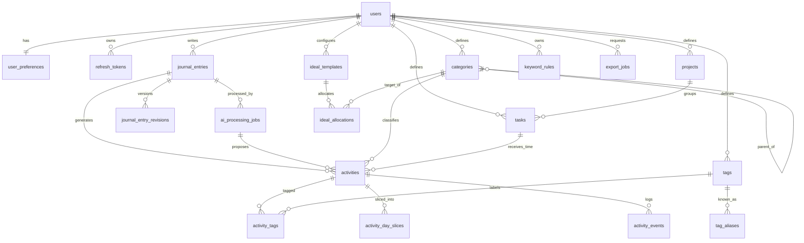

# 5 · Database Design & Data Dictionary

The schema has 22 tables on PostgreSQL 16. Three design choices carry most of the integrity: a database **exclusion constraint** that makes overlapping confirmed activities impossible, a **day-slice table** that makes midnight and DST arithmetic a write-time problem instead of a query-time one, and **stable ids** for categories, tags and tasks so renames, merges and archives never change history.

**Conventions.** Primary keys are `uuid` (`gen_random_uuid()`). Every user-owned table has `user_id uuid NOT NULL REFERENCES users ON DELETE CASCADE` and every index on such a table starts with `user_id` unless noted. Instants are `timestamptz` (UTC). Local dates are `date`. `created_at`/`updated_at` are `timestamptz NOT NULL DEFAULT now()` (updated by trigger). Enums are PostgreSQL enum types. "Req" = NOT NULL.

Required extensions: `btree_gist` (exclusion constraint), `pg_trgm` (search), `citext` (email), `pgcrypto` (uuid).

## 5.1 Entity relationships

**How the relationships work.**

- **Journal entry → activities (1:n).** An activity keeps `journal_entry_id`, `source_job_id`, the verbatim `source_quote`, character offsets and the entry `source_revision` it was cut from. Deleting an entry does not delete activities unless asked (FR-024).
- **Task → activities (1:n, optional).** `activities.task_id` is nullable, so a Task may have zero, one or many time records and an activity may have no task.
- **Tags (n:m).** `activity_tags` links by tag id, with the source (`ai`, `rule`, `alias`, `user`), confidence and reason. Tags are reused across activities and survive renames.
- **Category (n:1).** Exactly one `category_id` per activity gives the partition. `categories.path_ids` (root → self) allows subtree queries with `path_ids @> ARRAY[:id]`.
- **Ideal allocations.** `ideal_templates` are versioned by `(user_id, kind, effective_from)`; `ideal_allocations` hang off a version and reference categories.
- **Historical records.** Revisions keep every text version; `ai_proposed` keeps the first AI proposal; `activity_events` keeps what changed and who changed it; merged tags leave aliases; ideal versions are never edited after they take effect.

## 5.2 Data dictionary

### users

Purpose: the account. Hard-deleted on account deletion.

| Field | Type | Req | Default | Keys / rules |
| --- | --- | --- | --- | --- |
| id | uuid | Y | gen | PK |
| email | citext | Y |  | UNIQUE; valid email |
| email_verified_at | timestamptz | N | null | set on verification or Google sign-in |
| password_hash | text | N | null | argon2id; null for Google-only |
| google_sub | text | N | null | UNIQUE |
| display_name | varchar(80) | Y |  | 1–80 chars |
| role_title | varchar(80) | N | null | shown under the name in the sidebar |
| timezone | varchar(64) | Y | `Asia/Kolkata` | valid IANA name |
| theme | enum(system,light,dark) | Y | system |  |
| data_revision | bigint | Y | 0 | incremented on any analytics-relevant write (ETag source) |
| onboarding_completed_at | timestamptz | N | null |  |
| created_at / updated_at | timestamptz | Y | now() |  |

CHECK: `password_hash IS NOT NULL OR google_sub IS NOT NULL`.

### user_preferences (1:1 with users)

| Field | Type | Req | Default | Rules |
| --- | --- | --- | --- | --- |
| user_id | uuid | Y |  | PK, FK users |
| week_start | smallint | Y | 1 | 1 = Monday … 7 = Sunday |
| time_format | enum(12h,24h) | Y | 12h |  |
| coverage_tolerance_minutes | smallint | Y | 10 | 0–60 |
| gap_min_minutes | smallint | Y | 10 | 1–60 |
| short_night_minutes | smallint | Y | 420 | 240–600 |
| office_start_minute / office_end_minute | smallint | Y | 540 / 1080 | 0–1440, start < end |
| ai_enabled | boolean | Y | true |  |
| default_coverage_preset | enum(whole_day,last_hours,since_last,custom) | Y | whole_day |  |
| transcription_mode | enum(auto,server_only,browser_only) | Y | auto |  |
| updated_at | timestamptz | Y | now() |  |

### refresh_tokens

Purpose: rotating session tokens with reuse detection.

| Field | Type | Req | Default | Rules |
| --- | --- | --- | --- | --- |
| id | uuid | Y | gen | PK |
| user_id | uuid | Y |  | FK |
| family_id | uuid | Y |  | groups rotations; index |
| token_hash | char(64) | Y |  | SHA-256 hex, UNIQUE |
| created_at, expires_at | timestamptz | Y |  |  |
| rotated_at, revoked_at | timestamptz | N | null | reuse of a rotated token revokes the family |
| user_agent | varchar(200) | N |  |  |
| ip | inet | N |  |  |

### email_tokens

| Field | Type | Req | Rules |
| --- | --- | --- | --- |
| id | uuid | Y | PK |
| user_id | uuid | Y | FK |
| purpose | enum(verify_email, reset_password) | Y |  |
| token_hash | char(64) | Y | UNIQUE |
| expires_at | timestamptz | Y | verify 24 h, reset 1 h |
| used_at | timestamptz | N | single use |

### auth_events

| Field | Type | Req | Rules |
| --- | --- | --- | --- |
| id | bigserial | Y | PK |
| user_id | uuid | N | FK ON DELETE CASCADE |
| event_type | enum(login_ok, login_fail, logout, password_changed, reset_requested, reset_done, google_linked) | Y |  |
| ip | inet | N |  |
| user_agent | varchar(200) | N |  |
| created_at | timestamptz | Y | index `(user_id, created_at DESC)`; purged after 90 days |

### journal_entries

Purpose: the user's original words plus the window they claim to cover.

| Field | Type | Req | Default | Keys / rules |
| --- | --- | --- | --- | --- |
| id | uuid | Y | gen | PK |
| user_id | uuid | Y |  | FK |
| entry_date | date | Y |  | local date of `covers_start_at` in `timezone` |
| covers_start_at, covers_end_at | timestamptz | Y |  | CHECK end > start and end − start ≤ 24 h |
| timezone | varchar(64) | Y |  | IANA, captured at creation |
| raw_text | text | Y |  | 1–10,000 chars; current text; original in revision 1 |
| text_hash | char(64) | Y |  | SHA-256 of normalised text (dedupe, FR-055) |
| title | varchar(120) | N | null | AI summary or first 60 chars |
| input_method | enum(typed, dictated) | Y | typed |  |
| dictation_seconds | integer | N | null |  |
| status | enum(draft, processing, review, confirmed, failed, manual) | Y | draft | state machine in Section 4.5 |
| latest_job_id | uuid | N | null | FK ai_processing_jobs |
| revision | integer | Y | 1 | increments on text or window change |
| version | integer | Y | 1 | optimistic lock |
| created_at, updated_at | timestamptz | Y | now() |  |
| deleted_at | timestamptz | N | null | soft delete, purged after 30 days |

Indexes: `(user_id, entry_date DESC)`, `(user_id, status)`, GIN `raw_text gin_trgm_ops` (search).

### journal_entry_revisions

| Field | Type | Req | Rules |
| --- | --- | --- | --- |
| id | uuid | Y | PK |
| entry_id | uuid | Y | FK journal_entries ON DELETE CASCADE |
| user_id | uuid | Y | FK |
| revision | integer | Y | UNIQUE `(entry_id, revision)`; revision 1 = original, immutable |
| raw_text | text | Y |  |
| covers_start_at, covers_end_at | timestamptz | Y |  |
| created_at | timestamptz | Y | now() |

A trigger rejects `UPDATE` and `DELETE` on this table (append-only).

### ai_processing_jobs

Purpose: lifecycle and full audit of one extraction run. One row per run; regeneration creates a new row.

| Field | Type | Req | Default | Rules |
| --- | --- | --- | --- | --- |
| id | uuid | Y | gen | PK; also the queue idempotency key |
| user_id | uuid | Y |  | FK |
| entry_id | uuid | Y |  | FK journal_entries |
| job_type | enum(extract_activities) | Y | extract_activities | room for future types |
| status | enum(queued, running, succeeded, failed, cancelled) | Y | queued |  |
| attempts | smallint | Y | 0 | max 3 |
| entry_revision | integer | Y |  | revision processed; if the entry moves on, `is_stale = true` |
| text_hash | char(64) | Y |  |  |
| user_hint | varchar(500) | N | null | regeneration note |
| prompt_version | varchar(32) | Y |  | e.g. `extract_activities@1.0.0` |
| provider / model | varchar | Y |  | e.g. `anthropic` / `claude-sonnet-5-5` |
| raw_response | jsonb | N | null | untouched provider output |
| parsed_response | jsonb | N | null | validated and post-processed result (activities, gaps, conflicts, duplicates, questions, rejected) |
| input_tokens / output_tokens | integer | N |  |  |
| latency_ms | integer | N |  |  |
| error_code | varchar(40) | N |  | e.g. `INVALID_MODEL_OUTPUT`; never contains journal text |
| is_stale | boolean | Y | false |  |
| queued_at, started_at, finished_at | timestamptz | N |  |  |

Indexes: `(entry_id, created_at DESC)`, partial `(status, queued_at) WHERE status IN ('queued','running')`, `(user_id, created_at)` for the daily cap.

### projects

| Field | Type | Req | Rules |
| --- | --- | --- | --- |
| id | uuid | Y | PK |
| user_id | uuid | Y | FK |
| name | varchar(80) | Y | UNIQUE `(user_id, lower(name))` |
| color | char(7) | N | `#RRGGBB` |
| archived_at | timestamptz | N |  |

### tasks

| Field | Type | Req | Default | Rules |
| --- | --- | --- | --- | --- |
| id | uuid | Y | gen | PK |
| user_id | uuid | Y |  | FK |
| project_id | uuid | N | null | FK projects ON DELETE SET NULL |
| title | varchar(160) | Y |  | trigram index |
| description | text | N |  | ≤ 4,000 |
| priority | smallint | N | null | CHECK 0–3 (P0–P3) |
| due_date | date | N | null |  |
| status | enum(open, done, dropped) | Y | open |  |
| estimate_minutes | integer | N |  | > 0 |
| completed_at | timestamptz | N |  | set when status leaves open |
| created_at, updated_at, deleted_at | timestamptz |  |  |  |

Index `(user_id, status, due_date)`.

### categories

Purpose: the primary time-allocation tree (partition).

| Field | Type | Req | Default | Rules |
| --- | --- | --- | --- | --- |
| id | uuid | Y | gen | PK |
| user_id | uuid | Y |  | FK |
| parent_id | uuid | N | null | FK categories; null only for the 3 roots |
| root_kind | enum(work, personal, sleep) | Y |  | same as ancestor root; immutable once activities exist |
| depth | smallint | Y |  | CHECK 1–3 |
| name | varchar(60) | Y |  | UNIQUE among siblings, case-insensitive |
| path_ids | uuid[] | Y |  | root → self, maintained by service; GIN index |
| path_names | text | Y |  | e.g. `Work › Clients › Acme`, maintained by service |
| color | char(7) | Y |  |  |
| description | varchar(300) | N |  | sent to the LLM |
| counts_as_focus | boolean | Y | false | deep work, client work, learning |
| is_system | boolean | Y | false | the 3 roots and system children |
| is_transition | boolean | Y | false | target of **Mark as transition** |
| sort_order | integer | Y | 0 |  |
| archived_at | timestamptz | N |  |  |

Unique index `(user_id, COALESCE(parent_id, user_id), lower(name))`. CHECK: `parent_id IS NULL` ⇔ `depth = 1`.

### tags

Purpose: overlay labels.

| Field | Type | Req | Default | Rules |
| --- | --- | --- | --- | --- |
| id | uuid | Y | gen | PK |
| user_id | uuid | Y |  | FK |
| name | varchar(48) | Y |  | regex `^[a-z0-9][a-z0-9_-]*(:[a-z0-9][a-z0-9_-]*)?$`, UNIQUE `(user_id, name)`; shown with `#` |
| color | char(7) | Y |  |  |
| description | varchar(300) | N |  |  |
| goal_kind | enum(tracked, min, max) | Y | tracked |  |
| goal_weekly_minutes | integer | N | null | required when kind ≠ tracked; > 0 |
| archived_at | timestamptz | N |  |  |
| merged_into_id | uuid | N |  | FK tags; set when merged |

### tag_aliases

| Field | Type | Req | Rules |
| --- | --- | --- | --- |
| id | uuid | Y | PK |
| user_id | uuid | Y | FK |
| tag_id | uuid | Y | FK tags ON DELETE CASCADE |
| alias | varchar(48) | Y | UNIQUE `(user_id, lower(alias))`; may not equal any tag name (service) |

### keyword_rules

| Field | Type | Req | Rules |
| --- | --- | --- | --- |
| id | uuid | Y | PK |
| user_id | uuid | Y | FK |
| phrase | varchar(60) | Y | stored lowercase; whole-word match |
| target_type | enum(tag, category) | Y |  |
| tag_id / category_id | uuid | N | CHECK exactly one set, matching `target_type` |

UNIQUE `(user_id, phrase, target_type, COALESCE(tag_id, category_id))`.

### activities

Purpose: one time-bound record (the design's "task").

| Field | Type | Req | Default | Keys / rules |
| --- | --- | --- | --- | --- |
| id | uuid | Y | gen | PK |
| user_id | uuid | Y |  | FK |
| journal_entry_id | uuid | N | null | FK journal_entries ON DELETE SET NULL |
| source_job_id | uuid | N | null | FK ai_processing_jobs ON DELETE SET NULL |
| status | enum(draft, confirmed) | Y | confirmed | drafts are AI proposals in review |
| kind | enum(actual, planned) | Y | actual |  |
| title | varchar(120) | Y |  |  |
| description | text | N |  | ≤ 2,000 |
| category_id | uuid | Y |  | FK categories ON DELETE RESTRICT |
| task_id | uuid | N | null | FK tasks ON DELETE SET NULL |
| project_id | uuid | N | null | FK projects ON DELETE SET NULL |
| location_type | enum(office, home, remote, travel, other) | N | null |  |
| placement | enum(placed, unplaced) | Y |  |  |
| start_at, end_at | timestamptz | N |  | required when `placed` |
| window_start_at, window_end_at | timestamptz | N |  | required when `unplaced` ("some time in the afternoon") |
| duration_minutes | integer | N |  | required when confirmed; for `placed` equals interval length |
| time_certainty | enum(stated, inferred, estimated) | Y | stated |  |
| timezone | varchar(64) | Y |  | IANA captured from the entry or user |
| local_date | date | Y |  | local date of `start_at` or `window_start_at` |
| origin | enum(ai, manual, split, merge, duplicate) | Y | manual |  |
| confidence | numeric(3,2) | N |  | 0–1, AI only |
| needs_review | boolean | Y | false |  |
| flags | text[] | Y | `{}` | e.g. `quote_unverified`, `possible_duplicate` |
| source_quote | text | N |  | verbatim substring of the entry |
| source_start, source_end | integer | N |  | offsets into `source_revision` text |
| source_revision | integer | N |  |  |
| ai_proposed | jsonb | N |  | first AI proposal snapshot |
| user_edited | boolean | Y | false |  |
| derived_from_id | uuid | N |  | FK activities (split / duplicate parent) |
| merged_into_id | uuid | N |  | FK activities (merge target) |
| version | integer | Y | 1 | optimistic lock |
| created_at, updated_at, deleted_at | timestamptz |  |  |  |

Constraints:

- `CHECK (placement='placed' AND start_at IS NOT NULL AND end_at > start_at AND duration_minutes = EXTRACT(EPOCH FROM end_at - start_at)/60) OR (placement='unplaced' AND start_at IS NULL AND window_start_at IS NOT NULL AND window_end_at > window_start_at)`.
- `CHECK (status='draft' OR duration_minutes BETWEEN 1 AND 1440)`.
- **No overlap:** `EXCLUDE USING gist (user_id WITH =, tstzrange(start_at, end_at, '[)') WITH &&) WHERE (status='confirmed' AND kind='actual' AND placement='placed' AND deleted_at IS NULL)`.

Indexes: `(user_id, local_date)`, `(user_id, start_at)`, `(user_id, category_id)`, `(journal_entry_id)`, `(task_id)`, partial `(user_id) WHERE status='draft'`, GIN trigram on `title`.

### activity_tags

| Field | Type | Req | Rules |
| --- | --- | --- | --- |
| activity_id | uuid | Y | PK part, FK activities ON DELETE CASCADE |
| tag_id | uuid | Y | PK part, FK tags ON DELETE RESTRICT |
| user_id | uuid | Y | FK |
| source | enum(ai, rule, alias, user) | Y |  |
| confidence | numeric(3,2) | N |  |
| reason | varchar(160) | N | triggering phrase |
| created_at | timestamptz | Y |  |

Indexes: `(tag_id, activity_id)`, `(user_id, tag_id)`.

### activity_day_slices

Purpose: derived table, one row per activity per local day, **only for confirmed, actual, non-deleted activities**. All analytics read it (D-15). Rebuilt by `slice_service` on every relevant write.

| Field | Type | Req | Rules |
| --- | --- | --- | --- |
| activity_id | uuid | Y | PK part, FK ON DELETE CASCADE |
| local_date | date | Y | PK part |
| user_id | uuid | Y | FK |
| minutes | smallint | Y | 1–1440 |
| is_placed | boolean | Y | false for duration-only activities |
| slice_start_at, slice_end_at | timestamptz | N | null when unplaced |
| category_id | uuid | Y | denormalised copy for fast grouping |
| time_certainty | enum | Y | copy |
| location_type | enum | N | copy |

Indexes: `(user_id, local_date)`, `(user_id, category_id, local_date)`. Invariant checked nightly: for each activity, sum of slice minutes = `duration_minutes`.

### activity_events

| Field | Type | Req | Rules |
| --- | --- | --- | --- |
| id | uuid | Y | PK |
| activity_id | uuid | Y | FK activities (no cascade; history survives soft delete) |
| user_id | uuid | Y | FK |
| event_type | enum(created, edited, tagged, untagged, task_linked, split, merged, duplicated, approved, deleted, restored) | Y |  |
| actor | enum(user, ai, system) | Y |  |
| payload | jsonb | N | changed fields before / after; never the whole journal |
| created_at | timestamptz | Y | index `(activity_id, created_at)` |

### ideal_templates

| Field | Type | Req | Rules |
| --- | --- | --- | --- |
| id | uuid | Y | PK |
| user_id | uuid | Y | FK |
| kind | enum(day, week) | Y |  |
| effective_from | date | Y | UNIQUE `(user_id, kind, effective_from)`; a second save for the same date replaces the first |
| created_at | timestamptz | Y | index `(user_id, kind, effective_from DESC)` |

The version in force on date *d* is the row with the greatest `effective_from ≤ d`.

### ideal_allocations

| Field | Type | Req | Default | Rules |
| --- | --- | --- | --- | --- |
| id | uuid | Y | gen | PK |
| template_id | uuid | Y |  | FK ON DELETE CASCADE |
| user_id | uuid | Y |  | FK |
| category_id | uuid | Y |  | FK RESTRICT; UNIQUE `(template_id, category_id)` |
| minutes | integer | Y |  | > 0, multiple of 5; day ≤ 1,440, week ≤ 10,080 |
| distribution | enum(all_days, weekdays, weekend) | Y | all_days | day templates always `all_days` |

Service-enforced: sum = 1,440 (day) or 10,080 (week); antichain (FR-107).

### export_jobs

| Field | Type | Req | Rules |
| --- | --- | --- | --- |
| id | uuid | Y | PK |
| user_id | uuid | Y | FK |
| status | enum(queued, running, succeeded, failed, expired) | Y |  |
| file_key | text | N | R2 object key |
| size_bytes | bigint | N |  |
| expires_at | timestamptz | N | 24 h after completion |
| error_code | varchar(40) | N |  |
| created_at, finished_at | timestamptz |  |  |

### idempotency_keys

| Field | Type | Req | Rules |
| --- | --- | --- | --- |
| user_id | uuid | Y | PK part |
| key | varchar(64) | Y | PK part (client UUID) |
| endpoint | varchar(100) | Y | PK part |
| request_hash | char(64) | Y | a different body with the same key returns 422 |
| response_status | smallint | Y |  |
| response_body | jsonb | Y | replayed on repeat |
| created_at | timestamptz | Y | purged after 24 h |

## 5.3 Timezone and date-boundary handling

1. Stored instants are UTC. Each entry and activity stores its IANA `timezone`. A later change of the user's timezone setting never rewrites history.
2. A local date is derived from `(instant, timezone)`. Day = local midnight to next local midnight; on DST days a day is 23 or 25 hours long.
3. **Slice algorithm.** For a placed activity `[s, e)` in zone *Z*: for each local date *d* from `local(s)` to `local(e − 1 µs)` take `[max(s, midnight_d), min(e, midnight_{d+1}))`; minutes = elapsed instant difference. Elapsed instants make DST correct without special cases. For an unplaced activity create one slice on the local date of `window_start_at` with `is_placed = false`.
4. `elapsed_minutes` for a completed day equals the real length of that local day (1,440 normally, 1,380 or 1,500 on DST days); coverage divides by it.
5. Sleep metrics attribute a sleep activity to the local date of its `end_at` (wake date), separately from the slice partition (Section 2, M8).
6. Clients send local intent as `{local_date, time, timezone}` or ISO-8601 with offset; the server converts and validates, and refuses nonexistent local times (spring-forward gap) with `INVALID_LOCAL_TIME`.

## 5.4 Integrity, duplicates and consistency rules

| Concern | Mechanism |
| --- | --- |
| Overlapping time records | Exclusion constraint on confirmed actual placed activities (D-03) plus service pre-check for friendly errors |
| Duplicate activities | AI path: similarity detection (FR-044) and commit-time overlap constraint; manual path: overlap constraint; replays: `idempotency_keys` |
| Duplicate processing | `(entry_id, text_hash, prompt_version)` lookup within 10 min (FR-055) |
| Orphaned data | Foreign keys with explicit `ON DELETE` choices above; no orphan tags or categories because history references are RESTRICT |
| Concurrent edits | `version` columns with `UPDATE … WHERE version = :v`; 409 on mismatch |
| Derived data drift | `slice_service.rebuild(activity_id)` runs inside every transaction that changes time, category, status, kind or deletion; nightly invariant query reports mismatches |
| Historical consistency | Analytics join by ids; renames change labels only; merges repoint rows and leave aliases; category cross-root moves with data are refused; ideal versions are append-only once effective |
| Soft delete | `deleted_at` on entries, activities, tasks; excluded by every repository query; purged after 30 days |
| Tenant isolation | `user_id` on every row and every repository method; Phase 5 adds row-level security |

## 5.5 Migrations and seed data

Alembic migrations only; each is reversible except data-destroying ones (documented in the file). The first migration creates extensions, enum types and all tables. Seed on onboarding (not in migrations): three root categories plus the suggested children (Work: Deep work, Meetings, Sales & clients, Admin, Learning; Personal: Health, Family & friends, Meals & chores, Commute, Entertainment, Transitions; Sleep) and a handful of example tags and keyword rules the user may delete.

